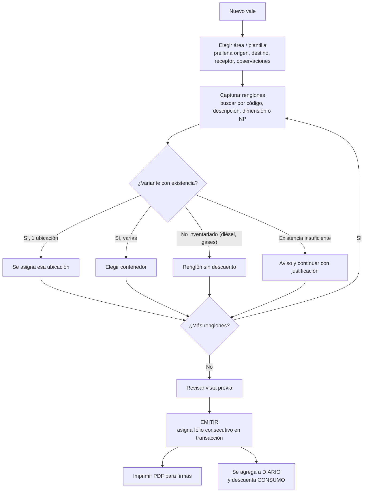
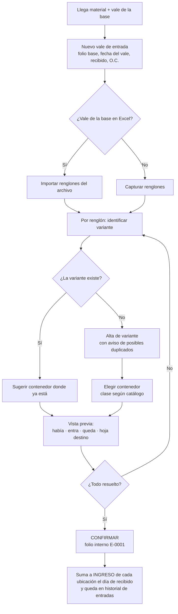

# 05 — Flujos de trabajo

## 1. Vale de salida (consumo o transferencia)

- **Borradores:** se pueden tener varios abiertos en pestañas. No consumen folio y se guardan automáticamente (sobreviven a cerrar la pestaña). Descartar uno es inmediato y el aviso ofrece **Deshacer**.
- **Pantalla:** a la izquierda los datos del vale: primero lo que se captura (área, fecha; en transferencias origen y destino; personas, etapa) y al final, en "Se llenan solos", lo automático (quién entrega, de dónde sale, a dónde llega y las observaciones fijas). Al centro las **partidas** y, debajo, en su propia sección, las **fotos** (NOV). Las partidas van con las mismas columnas y en el mismo orden que el vale impreso (O.C., cantidad, código, descripción, clave almacén, presentación, lote). Lo que viene del inventario (contenedor, existencia) se muestra en **pastillas grises**, aparte de lo que se imprime.
- **Pantalla de cada almacenista (Ajustes → Mi pantalla de vales):** el orden de los bloques del panel de datos se cambia arrastrándolos por sus puntitos (o con ↑ ↓) en una vista previa, y un botón pasa los datos al otro lado de las partidas. Se guarda por almacenista y se aplica según quién está en turno; lo descrito arriba es el acomodo de fábrica (*Restablecer como venía*).
- **Vales internos** (todo menos NOV y transferencias): salen de `EQUIPO · ALMACEN` y llegan a `EQUIPO · <área>`; no se capturan. **Entregó** es siempre el almacenista en turno. **Autorizó** solo aparece en transferencias. Las **observaciones** son el texto fijo del área y solo cambia la **etapa de perforación**, que se recuerda para el siguiente vale.
- **Recibió:** se busca por nombre, por puesto o por el área a la que la persona suele recibir ("mecánico" lista a los mecánicos); al elegirla se llena su puesto.
- **Partidas (paso a paso):** código AX → `Enter` → **clave**: la lista muestra solo las claves de ese código en el inventario, cada una con su contenedor y existencia (si solo hay una, se elige sola) → `Enter` → cantidad → `Enter` pasa a la siguiente partida. "Otra clave" deja la partida como no inventariada (no descuenta). Un artículo sin existencia (diésel) queda no inventariado y la clave se escribe a mano; un código que no está en el catálogo se acepta con su descripción y queda "por confirmar".
- **Búsqueda rápida (opcional, en Ajustes):** un buscador por cualquier dato que llena la partida completa con `Enter`.
- **Validaciones antes de emitir:** fecha, departamento destino, entregó, recibió, cantidad > 0, UM, "Sale de" elegido. Si la cantidad supera la existencia del contenedor elegido se pide una **justificación** (queda en el renglón).
- **Emitir** es el único paso que asigna folio: el último + 1, dentro de un cambio atómico con candado de pestaña única. Un vale con errores no consume folio. **Todos los folios se usan:** ninguno se cancela ni se salta.
- **Más renglones que el formato:** cada hoja-formulario tiene su capacidad (21, 20 u 19 renglones). Si el vale la supera, la herramienta avisa y ofrece dividirlo en folios consecutivos (P-16).
- **Transferencias:** la plantilla `TRANSFERENCIAS` exige "Autorizó" y marca la naturaleza como `TRANSFERENCIA`.
- **NOV (diésel):** área externa con datos fijos (sale de `EQUIPO · ALMACEN` hacia el tanque de NOV; observaciones fijas + etapa). Lleva **4 firmas**: a la izquierda el químico (arriba, "Recibió") y el personal de NOV (abajo); a la derecha el almacenista (arriba) y patrimonial (abajo). Las personas y la partida de diésel (sin cantidad) se toman del último vale NOV hecho en la herramienta. Lleva **3 fotos**, que se imprimen en el lugar y tamaño de las del formato; las partidas caben arriba de ellas (4). En el DIARIO, como hacía la macro, "Entrego" es el químico y "Recibio" el almacenista.
- **Autorizó (transferencias):** nombre y puesto; se sugieren primero RESPONSABLE e ITP.
- **Personas:** se muestra su puesto; quien más ha firmado para esa área aparece primero.
- **Impresión:** el vale se dibuja sobre **la hoja-formulario del propio libro de vales** (logo, colores, bordes, anchos, observaciones y pie de página) en tamaño carta, y se imprime o se guarda como PDF desde el navegador. La vista previa de un borrador lleva `BORRADOR` en el folio.
- **Folios hechos fuera de la herramienta:** si se siguieron haciendo vales en el Excel, *Exportar y enviar → Traer vales hechos en el Excel* agrega los folios posteriores al último conocido. No hay forma de saltar folios: los hechos fuera se traen del Excel.

## 2. Vale de entrada (material recibido de la base)

**Así se evita meter material al contenedor equivocado:**
1. Si la variante ya vive en un contenedor, se propone ese.
2. Si vive en varios, se propone el que tiene más existencia (★ sugerido); "Entra a" permite elegir otro (si la
   variante no está ahí, se crea su renglón al final de esa hoja).
3. Una dimensión nueva (variante nueva) va al contenedor donde ya vive el código (se cambia en "Entra a") y avisa si
   se parece a una que ya existe ("¿Es la misma que…?").
4. Cada partida muestra a qué hoja entra y cuánto *hay → queda* (o *renglón nuevo → queda*).
5. No se registra con renglones sin destino ni con un folio de la base ya registrado (salvo que se marque que es otro vale).
6. Nada se aplica hasta confirmar, y una entrada confirmada se puede **corregir** con motivo (como los vales de salida,
   sin cancelar folios; el motivo se llena solo con los cambios).

**Dos fechas (Ronda 22):** *Fecha del vale* (cuando la base lo envió; la llena Copilot) y **Recibido** (cuando llegó; por
omisión, hoy). La de **recibido** decide en qué día suma al inventario, en qué *reporte diario* cuenta, las entradas de
hoy del inicio y los filtros *Recibido desde / hasta* del historial (que muestra las dos columnas). No puede ser futura
ni posterior al día en que se registra (al corregir, el día en que se registró): no se registra lo que aún no llega.
Avisa sin bloquear si es anterior a la del vale o si hubo un **conteo físico después** en las partidas de destino («si ya
se contó, la entrada lo sumaría dos veces»). Se cambia con *Corregir* (queda en la bitácora: «Recibido: … → …»). La
conciliación con AX sigue con la fecha del vale.

En la herramienta el vale de la base se **captura** (llega en papel, P-04), a mano o desde su foto/PDF con Copilot;
leerlo directo de un Excel queda como mejora futura (RF-35). Diésel, gases y lo que no lleva existencia se registran con *Sin existencia* (no suman).

El vale de entrada solo pide **de dónde viene** (la base o un equipo); el departamento siempre es ALMACEN y no hay
"motivo" que elegir (comentario del usuario). Al crear una entrada se elige cómo capturarla: **Captura manual** o
**Desde foto o PDF** (captura asistida con Copilot, ver abajo).

**Pantalla (ronda 6):** una barra fija arriba con el folio interno, el número de partidas, las que están *por revisar*,
los *datos pendientes* (al pulsarlos se ve la lista y cada uno lleva a su campo) y los botones **Copilot**,
**Descartar** y **Registrar entrada**, siempre a la vista. Debajo, los datos del vale en un renglón (folio, viene de,
fecha del vale, recibido, entregó; lo automático en una línea). Cada partida es una tarjeta de dos líneas: lo del vale (código,
descripción, clave / dimensión, cantidad, U.M.) y abajo **Entra a** (el contenedor, con *hay → queda*), **Solicita**
(va en la columna LOTE) y la O.C. Si la clave escrita no existe en el inventario, la partida es una **variante nueva**
con esa misma dimensión (no se escribe dos veces) y va al contenedor donde ya vive el código (se cambia en *Entra a*);
si se parece a una que ya existe, se ofrece usar esa.

**NP (ronda 8):** cada partida tiene su campo **NP** (el número de parte del inventario). Al elegir un renglón trae su
NP; otro NP es otra variante (misma dimensión) en el mismo contenedor. Si la clave escrita o leída por Copilot trae el
NP (`6309-2Z NP: SKF123`, `N/P`, `P/N`, `No. de parte`…), al salir del campo se separa: la dimensión queda en la clave y
el NP pasa a su campo (`separarNp`; no confunde la rosca `NPT`).

**Lo que requiere atención (ronda 8):** en la barra, *⚠ pendientes*, *por revisar* (Copilot no estaba seguro) y *con
clave nueva* son botones: muestran solo esas partidas, con sus mensajes en cada tarjeta, y marcan *✓ resuelta* las que
se van arreglando. Al pulsar *Registrar* con pendientes se filtran solas.

**Quién solicita:** en los vales de la base, la columna LOTE trae el nombre y apellido de quien pidió el material. En
la entrada, LOTE = *Solicita* de cada partida (no el NP del inventario); también lo lee Copilot (`"lote"`).

**Material que regresa** (P-08): *↩ Copiar partidas de un vale de salida* → folio. Cada partida regresa al renglón del
inventario del que salió; se ajusta la cantidad a lo que regresó. Si la base aún no capturó el vale en AX, también se
puede corregir el vale de salida original.

**Captura asistida (Copilot):** tres pasos — copiar las instrucciones, pegarlas en Copilot con la foto o el PDF y pegar
aquí la respuesta con el botón **Pegar** (o `Ctrl+V` en el cuadro; se carga sola). Se ve *✓ Listo* y la guía da paso
suave a las partidas, que entran una tras otra y destellan un momento. Se llena el borrador (entrada) o la captura (conteo: por contenedor + ITEM
de la hoja impresa, confirmando con el código); lo dudoso, lo que no se leyó (código o clave) y lo no reconocido se
reporta y se marca en amarillo. Si la respuesta viene **cortada o mal formada** (llaves o corchetes sin cerrar, comas
de más o de menos, comillas tipográficas, claves sin comillas, `True`/`None`, comentarios, varias hojas en bloques
separados), se arregla sola (`servicios/jsonTolerante.js`) y se avisa qué se corrigió. Acepta también nombres
parecidos (`renglones`, `clave`, `solicita`, `unidad`…). La herramienta no se conecta a ningún servicio
(`src/servicios/capturaIA.js`).

## 3. Corrección y devolución

| Caso | Qué hace la herramienta |
|---|---|
| **Error de captura** en un vale emitido | *Historial → folio → Corregir*. El **motivo se llena solo** con lo que cambió (partidas agregadas, quitadas o modificadas, personas, etapa, fotos) y se puede completar con el porqué. El folio no cambia. La bitácora guarda el motivo, la lista de cambios y antes → después; la existencia se recalcula sola. En un vale anterior al conteo solo cambia el historial (no mueve existencias). |
| **Vale que no debió emitirse** | No se cancela (todos los folios se usan): se corrige para que refleje lo que realmente salió. |
| **Devolución de material** | Vale de entrada con *Copiar partidas de un vale de salida*: referencia el folio y regresa cada partida a su renglón. Si la base aún no lo captura en AX, también se puede corregir el vale original (P-08). |
| **Vale ya subido al SharePoint y luego corregido** | Vuelve a aparecer en *Subir al SharePoint* (Inicio y *Exportar y enviar*) con el cambio "Corregido", para avisar a la base. |

## 4. Conteo físico

1. Elegir el alcance: todo o algunos contenedores (*Conteo físico*).
2. (Opcional) Imprimir la hoja de conteo por contenedor, sin cantidades ("a ciegas"), con renglones en blanco para lo encontrado.
3. *Empezar a capturar*: se guarda el corte (último folio de salida y de entrada) de ese momento. La captura se guarda
   sola y no cambia nada del inventario.
4. Capturar lo contado. Se ve la diferencia contra lo que dice el sistema (`TOTAL`), o se oculta para capturar a ciegas.
   Lo encontrado que no tiene renglón se agrega con su contenedor (va al final de esa hoja).
5. Si se emitieron vales mientras se contaba, la herramienta pregunta si el material ya había salido/entrado al contar
   (el corte queda al empezar o al aplicar).
6. Aplicar: en cada renglón contado `CANTIDAD` = contado y CONSUMO/INGRESO se reinician; los no capturados conservan su
   conteo anterior. El conteo guarda por renglón lo que había antes y se ve en *Conteos anteriores* con sus diferencias.

### 4.3 Conteo de auditoría: reemplazar lo inventariable (Rondas 23 y 24)

El Kardex de la auditoría (el reporte de AX con las columnas **Conteo** o **Conteo Fisico** y **Contenedor**; un libro con
una hoja por inventario o un archivo por inventario) se carga en *Conteo físico → Conteo de auditoría (Kardex)*:
1. **Unir cada hoja con su inventario** (como el juego de unir parejas): a la izquierda Inventario A, Inventario B y FX; a
   la derecha las hojas de los archivos cargados. Se toca uno de cada lado y queda una línea del color del inventario;
   tocar otra vez la pareja la separa. **La herramienta no adivina ni revisa códigos**: lo que se une es lo que se usa
   (los inventarios pueden tener códigos parecidos y cada hoja se registra en su lugar). Lo que no se une no se usa.
2. **Fecha y corte:** la del nombre del archivo; el corte es el último vale de salida y de entrada de ese día (editable):
   los vales posteriores se descuentan solos del conteo, aunque el almacén ya se haya abierto.
3. **Reemplazo** (vista previa; nada cambia hasta aplicar). El Kardex **reemplaza** lo inventariable de las hojas unidas:
   - **Lo idéntico se queda** (mismo código, dimensión igual a la de AX y una sola variante): conserva su partida, su NP
     y sus vales y toma el conteo. Si había varias, se queda la del dueño (FX / del inventario), luego la del contenedor
     que anotó el conteo y luego la de cantidad más cercana.
   - **Lo demás sale del Kardex:** partida nueva con la escritura de AX en la hoja inventariable del contenedor que anotó
     el conteo (si no existe, donde estaba el código; si tampoco, se elige). Si AX cuenta junto lo que el inventario
     separaba por NP (por ejemplo, botoneras sin dimensión con distinto NP), queda **una** partida con el total; el
     almacenista puede ir a comprobar la que necesite.
   - **Lo inventariable que no quedó se da de baja**, solo de los dueños de las hojas unidas (sin la hoja de FX, lo de
     FX no se toca). *Sustituida* si su código viene en el Kardex; *sale* si no viene. Las que tienen vales posteriores
     al conteo pasan sus partidas de vale a la que las reemplaza; si no hay con qué reemplazarlas, se quedan y se avisa.
   - **Listas de revisión** (se imprimen antes o después de aplicar): **NP que se pierden** (sustituidas con NP, y con qué
     partida quedó cada una) y **Salen del inventario** (no vienen en el Kardex). El NP se vuelve a anotar a mano en
     *Inventario* (lápiz de la columna NP, sugiere los que tenía el código).
   - **No se tocan:** lo consumible (aunque el Kardex lo cuente) y, en el Inventario B y FX, los códigos de **3 dígitos**
     (siempre son consumibles; solo los de 4 dígitos son inventariables; en el Inventario A no aplica).
   - **Cambios por artículo** (los de más impacto en $ primero): cada código con lo que tenía, lo que tendrá y qué pasa
     con cada partida.
4. *Reemplazar lo inventariable*: antes se guarda una copia interna (y un respaldo si hay carpeta). Opcional: guardar el
   *Disponible* de AX de la hoja propia como corte de AX de ese día para justificar faltantes en la conciliación.
5. **El otro inventario:** el Kardex y las parejas se quedan cargados en la pestaña; *Ir a <inventario> para aplicar…*
   abre el otro y su vista previa sin volver a cargar el archivo. Aplicar otra vez el mismo Kardex no cambia nada.

**Mover material entre contenedores** (*Inventario → Mover*): cantidad y contenedor de destino. El total no cambia; los
dos renglones quedan como recién contados y el movimiento queda en *Movimientos entre contenedores*.

## 5. Conciliación con Dynamics AX

- **Solo modelo INV:** se concilian las partidas de AX con *Modelo de Inventario* = `INV`; las de otros modelos (diésel,
  servicios…) no, y si un código solo viene con otro modelo, su físico tampoco se compara.
- **En AX la dimensión es `Tamaño + Color`** (dos columnas que juntas son la DIMENSION física); AX **no trae NP** y
  corta el `Tamaño` a 10 caracteres.
- **Emparejamiento** (`servicios/conciliacion.js`): exacto tras normalizar: dimensión = `Tamaño + Color` (o = `Tamaño`
  cuando no hay Color; si el inventario anotó el Color en la columna NP, también empareja), o `Tamaño` de 10 caracteres
  con el que empieza la dimensión física (y termina con el Color); las unidades se comparan equivalentes (`m` = `MTS`,
  `LITROS` = `LTS`…); aproximado con puntaje (se **sugiere**). Al confirmar (*Corregir a como está en AX*, *Ajustar…* u
  *Otra…*) **la dimensión de la variante pasa a `Tamaño + Color`**. **Una partida del inventario solo puede ser pareja de
  una partida de AX:** las que ya emparejan (exactas o confirmadas) no se sugieren ni aparecen en *Otra…*; cada variante
  libre se sugiere a una sola partida de AX (la más parecida) y no se permite una corrección que la juntaría con una ya
  emparejada; si no queda ninguna libre, la partida de AX va a "No está en el físico" (todas sus partidas; si ya había una igual, se
  juntan); el NP se conserva, salvo que fuera el mismo Color anotado como NP. Desde ahí empareja exacto: no hay memoria
  aparte. La escritura anterior queda en `claves_anteriores` para seguir reconociendo los vales viejos. *No está en el
  físico* se anota solo en ese corte. Un código de AX sin ninguna partida física va directo a "en AX y no en el físico".
  Cada corrección tiene *Deshacer* en el aviso y queda en la bitácora (`CORREGIR_CLAVE`).
  También agrega una etiqueta de Material por partida física modificada; Deshacer retira esas etiquetas nuevas.
- **AX sin dimensión (Ronda 15):** si una partida de AX no trae Tamaño ni Color (vacíos o `S/D`), AX no distingue
  entre las variantes que tampoco tienen dimensión, así que se comparan **todas juntas** en una sola fila (físico =
  suma de todas): si es la **única partida del código en AX**, es el **código completo** (todas sus variantes, aunque
  alguna tenga dimensión); si el código tiene otras partidas en AX con dimensión, solo las variantes **sin dimensión**.
  "Sin dimensión" = vacía, `S/D`, `SIN DIMENSIÓN` / `SIN DIMENCION`, `S/N`, o un texto que empieza así (`S/D NP: …`,
  `S/D CABLE UTP`: lo que sigue es NP o descripción). No se corrige el inventario (AX no trae dimensión que copiar). Si
  el Color trae algo (`S/D` + `X00489`, un NP), se empareja normal.
- **Misma dimensión y varios NP:** AX no trae NP. Si varias variantes del mismo código coinciden con Tamaño / Color y
  unidad, su físico y su tránsito se suman en una sola fila (*Misma dimensión*). Así, 2 + 2 piezas frente a AX 4 cuadran.
  Una partida con Color específico tiene prioridad sobre otra que sólo trae Tamaño; las unidades distintas no se suman.
  Las abreviaturas de pieza / unidad (`PZA`, `PZ`, `EA`, `UND`, `UNIDAD`, `PCS`…) se comparan 1 a 1, también con puntos
  (`PZA.`, `P.Z.A.`), sin reescribir las unidades originales. Caja, juego, kilo, metro y litro requieren su propia medida;
  no se convierten a piezas. El selector muestra la unidad de AX y, al bloquear una partida, también la unidad física.
  Los duplicados de la misma llave AX comparten grupo y suman su Disponible; el físico sólo se cuenta una vez.
- **Elegir del inventario** (`servicios/vinculosAx.js`, formato 15): desde *Justificar faltantes*, *Reporte AX* o
  *Diferencias*, seleccionar dimensiones / NP del mismo código, revisar el total y el resultado con los vales existentes,
  y confirmar. Cada opción reúne todas sus partidas y muestra sus contenedores. Sólo se permiten variantes libres o ya
  usadas por esa misma llave AX, con unidad compatible. Se guarda en el corte, con auditoría y Deshacer; se puede volver
  al automático. Por defecto conserva cantidades, claves, etiquetas y vales. La opción **También corregir las claves
  del inventario a como están en AX y preparar etiquetas** revisa las claves de destino, el resultado real con tránsito
  y una etiqueta por partida modificada; corrige y vincula al confirmar. El NP se conserva salvo si repite el Color de
  AX. Si las claves se unen a una variante existente, se muestra el total conjunto. Deshacer restaura claves, vínculos
  y etiquetas añadidas, y protege ediciones posteriores. Al variar el saldo se recalcula: el vínculo no fuerza que cuadre.
- **Corrección de unidad y conversión** (formato 16): el selector muestra UM de AX y físico. Las abreviaturas
  equivalentes de piezas se aceptan automáticamente 1 a 1. Para unidades diferentes se activa **Corregir la unidad
  del inventario a la de AX**, se eligen las variantes y se indica una equivalencia positiva por variante (p. ej.
  1 CJA = 12 PZA, o 1 = 1 si la unidad estaba mal anotada). Se revisa cada partida: clave, cantidad y unidad
  actuales → corregidas, resultado con tránsito y etiquetas. Confirmar convierte el conteo, guarda las equivalencias
  y factores de movimientos y prepara una etiqueta por partida modificada. Los vales conservan su captura;
  existencias, justificantes y solicitud se expresan en la unidad vigente. Deshacer protege movimientos posteriores.
  Las correcciones de dimensión, NP y UM permanecen en inventario y se reconocen automáticamente en futuros cortes
  con las mismas claves de AX; el vínculo simple sigue siendo exclusivo de su corte.
- **Revisión de claves AX:** en *Emparejar con AX*, las sugerencias del corte actual muestran dimensión, cantidad,
  unidad y fecha. Elegir una muestra el destino, físico y resultado con tránsito, y cuántas etiquetas se agregarán a
  *Etiquetas → Material*. *Revisar corrección → Confirmar corrección y etiquetas* guarda la acción. Desde ese editor,
  *Elegir varias partidas para este AX…* abre la selección del mismo destino, sin guardar cambios al abrirla.
- **Existencia física para comparar:** el `TOTAL` calculado de todas las ubicaciones de esa variante o de todas las
  variantes del grupo automático o manual.
- **Vales en tránsito:** los vales (salidas y entradas) posteriores al corte AX. Se usa la fecha de corte o, si se conoce, el último folio aplicado por la base (P-03; se puede escribir en la pantalla). En las entradas cuenta la **fecha del vale**, no la de recibido (Ronda 22): la base mueve el material en AX cuando lo envía. Las partidas sin renglón ligado (vales migrados) que son **anteriores al conteo** de su renglón cuentan (la cantidad contada ya las refleja: caso del primer corte); las posteriores al conteo, aún por ubicar, no mueven existencia y se muestran como pista.
- **Con el archivo de vales de la base (Rondas 12 y 13)** lo único que importa es si la partida tiene **folio de AX**:
  - Con folio IN / TR ya está en AX (CANTIDAD vacía = todo): no justifica diferencias.
  - **Sin folio IN / TR** está en tránsito aunque el vale sea anterior al corte, dentro del periodo admitido: `INV` sin folio (o `PENDIENTE`), sin
    revisar (INV/NINV vacío), partidas que la base no tiene y vales posteriores al último folio de su archivo; de una
    aplicación parcial, lo que falta. Folio `6 (S, sin IN/TR)` o `1 (S, 2 sin IN/TR)`.
  - `NO INV`, `CONPROV` o `SIN EXISTENCIA` no se descuentan en AX: no justifican diferencias y quedan como pista en la
    vista por artículo. Una partida **duplicada** que la base no tiene tampoco cuenta (es un error del vale).
  - La fecha del archivo de la base **no importa** (se usa el último importado). La que importa es la del **reporte de
    AX**: es una foto de ese día, así que lo posterior (salidas y entradas) siempre está en tránsito, tenga o no folio.
  - Para que la regla funcione, el archivo de la base debe traer todos los vales hasta la fecha del reporte de AX: un
    vale que la base ya aplicó pero que su archivo no tiene cuenta como sin IN / TR.
- **Avisos de diferencias entre la base y los vales:** cada fila de la base se empareja con la partida del vale por folio
  y código (luego clave y cantidad). Se avisa cuando la base anotó otra clave u otra cantidad, aplicó menos (o más) de lo
  del vale, escribió texto en CANTIDAD (`REGRESAR`), marcó NO INV con folio de AX, tiene una partida que el vale no tiene,
  o falta una partida del vale (si está **duplicada** en el vale, lo dice).
- **Partidas duplicadas en un vale:** mismo código, clave y cantidad que otra partida del mismo vale (el formulario de
  Excel a veces guardaba el vale dos veces). Se marcan en el historial (filtro *Revisar → Duplicadas en el vale*) y en el
  detalle; *Quitar duplicadas…* abre la corrección sin ellas y con el motivo escrito (folio intacto, bitácora).
- **Justificar faltantes (Ronda 14):** un faltante (físico < AX) se explica con vales que el físico ya descontó y AX no.
  Los que no cuentan solos (su clave no ubica una sola partida del inventario, son de antes del reporte, la base les puso
  folio pero los aplicó después…) se **asignan** al faltante (`servicios/justificacion.js`). Candidatas: partidas de
  salida del mismo código (sin NO INV ni duplicadas sin registro), cada una con su estado: *sin IN / TR* (libre),
  *justifica otra* (moverla deja de explicar aquella), *ya en AX* (solo si AX la aplicó después del reporte), *sin archivo de
  la base*, *por ubicar* (posterior al conteo y sin partida ligada: el físico aún no la descuenta; no se puede) o *ya
  justifica aquí*. **Sugerencias:** solo libres que coinciden en dimensión (misma clave, o el código tiene una sola
  partida); se elige la combinación que cubre el faltante exacto con menos vales o, si no, la que más se acerca sin
  pasarse; cada vale se sugiere a un solo faltante (los más grandes eligen primero). Se aprueban una por una o todas
  (`asignarSugeridas`, con confirmación); a mano con *Elegir vales…*. Lo asignado sale en *VALES POR APLICAR*.
- **Diferencia explicada** = físico − AX + salidas en tránsito − entradas en tránsito. Si da 0, la diferencia se marca como "explicada por vales" y se listan los folios; si no, queda como **sobrante** o **faltante** sin explicar.
- **Límite anual de justificantes:** cada corte propone el 1 de noviembre del año anterior al reporte AX. *Justificar
  faltantes → Aceptar vales desde → Guardar límite* permite otra fecha por prórroga o retraso. Antes de esa fecha no se
  sugieren ni aceptan vales, ni cuentan como tránsito o en la solicitud. Las asignaciones previas fuera del periodo
  se conservan para revisión, con aviso y sin justificar diferencias. Cambiar el límite no cambia los vales.
- **Valuación:** costo unitario = Valor financiero / Disponible del renglón AX; valor = lo sin explicar × costo.
- **Pantalla (Ronda 14):** al centro un bento con lo que **se hace**: *Enviar a la base* (solicitud de ajuste), *Por
  resolver* (*Emparejar con AX*, con pestañas para lo que solo está en el físico o solo en AX, y *Justificar faltantes*),
  *Diferencias contra AX*, *Reporte AX* (kardex completo) y *Consumos de la base*; a un lado, el **Resumen**, que solo
  informa (emparejadas, cuadran, explicadas, faltantes, sobrantes, solo en AX, solo en el físico, valuada, códigos y
  contenedores con diferencia) y abre el detalle de cada cifra. Todo se abre en **ventanas en primer plano** con buscador.
- **Vistas:** por partida de AX, por artículo (código, sin depender del emparejamiento), por contenedor y valuada; filtros
  *todos, con diferencia, sin explicar, sobrantes, faltantes, explicadas, cuadran, por confirmar*. **Todos** (mosaico
  *Todo el reporte de AX*) trae cada partida INV del reporte: emparejadas con su resultado, **por confirmar** (con la
  sugerida y *Confirmar…*, que abre esa partida en *Por confirmar*) y sin físico; con la casilla *Incluir lo que solo
  está en el físico*, también eso. Cada mosaico cuenta lo mismo que su filtro. Aparte, las listas "en AX y no en el físico"
  y "en el físico y no en AX" (RF-55; en esta última se puede corregir la dimensión / NP).

## 6. Reporte diario, exportación y SharePoint

*Reporte diario* (en el menú, después de *Conteo físico*; o *Inicio → Crear reporte diario*), con la fecha en la
página: entrega los dos libros **como estaban al cierre de ese día**
(`servicios/corte.js`, `estadoAlCierre`), aunque después se hayan hecho más vales o movimientos:

- **Libro de vales de salida** (`.xlsm`): hasta el último folio con fecha de ese día o anterior. El `DIARIO` se abre
  completo, con las filas visibles y los rangos de tabla y filtro actualizados aunque la plantilla tuviera filtros
  guardados o filas ocultas. Esto también se aplica al libro de Inventario B.
- **Inventario de refaccionamiento** (`.xlsx`, con esa fecha en el nombre): CONSUMO e INGRESO solo con los vales y
  entradas hasta ese corte; los conteos y movimientos posteriores se deshacen (cada línea de conteo guarda la cantidad
  y el conteo anteriores) y no aparecen los renglones creados después. Las correcciones se toman como están hoy.
- **Entradas por su fecha de recibido** (Ronda 22), no por folio: como se puede corregir, E-0002 pudo recibirse antes
  que E-0001. Entran las recibidas hasta ese día; un renglón que creó una entrada recibida después no aparece (salvo que
  otra que sí entra también llegue a él). La página lo dice: «entradas recibidas hasta el 08/10/2026: hasta E-0002 (menos
  E-0001, recibida después)», y en *Material recibido* lista lo que llegó ese día (con la fecha de su vale si es otra).

También muestra los vales y entradas del día y *Subir al SharePoint* limitado a ese corte: **✓ Ya lo subí** marca solo
los vales hasta ese folio (`vale.subido_cambio`); los posteriores siguen pendientes para el reporte de su día.

1. **Exportar → Vales:** genera `VALES DE SALIDA <inventario>.xlsm` sobre la plantilla registrada, con `DIARIO` completo y actualizado.
2. La herramienta valida el archivo, lo guarda en la carpeta de exportaciones y registra hasta qué folio se incluyó.
3. El usuario lo sube al SharePoint y pulsa **"✓ Ya lo subí"**. *Subir al SharePoint* muestra los vales nuevos o corregidos desde la última subida (se lleva con un contador de cambios, no con la hora, para que no se escape ninguno).
4. **Exportar → Inventario:** genera el `.xlsx` con fecha en el nombre, cuando se necesite.

## 7. Cambio de guardia

1. El almacenista que sale genera el **resumen de guardia**: vales emitidos, entradas, cancelaciones, pendientes de envío y alertas.
2. El que entra elige su nombre al abrir; desde ese momento los movimientos quedan a su nombre.

## 8. Respaldo y restauración

> Cada inventario (Inventario A y Inventario B) tiene sus respaldos (`almacen_…` y `almacen_<inventario>_…`). Se restaura estando en el
> inventario del respaldo; uno del otro se rechaza con un aviso que dice a cuál cambiarse.

- Los respaldos automáticos funcionan como se describe en [03-arquitectura.md](03-arquitectura.md#almacenamiento-y-respaldos).
- **Equipo o navegador nuevo:**
  1. Abrir `ControlAlmacen.html` en Edge (no se instala nada).
  2. **Respaldos → Restaurar desde un archivo…** y elegir el `.zip` más reciente de `OneDrive\ControlAlmacen\respaldos`.
  3. La herramienta valida el respaldo (formato, folios únicos, plantillas completas) antes de reemplazar.
  4. Elegir otra vez la carpeta de respaldos; queda lista.

## 9. Dos inventarios: Inventario A y Inventario B (Ronda 17)

1. Arriba, junto al nombre de la herramienta, el selector **Inventario: Inventario A | Inventario B** dice en cuál estás (Inventario A azul, Inventario B
   morado: también la franja de la cabecera, el logo y el título de la pestaña). Al abrir, entra al último que usaste.
2. **La primera vez Inventario B está vacío:** *Primera carga* con el inventario y el libro de vales de Inventario B. Desde ahí lleva sus
   propios vales y folios, entradas, conteos, plantillas, respaldos, reporte diario y conciliación con Dynamics AX.
3. Si eliges un archivo cuyo nombre dice el otro inventario (por ejemplo `…Inventario A…` estando en Inventario B), la herramienta pregunta
   antes de leerlo (primera carga, traer vales del Excel, reporte de AX y archivo de la base).
4. **Vale impreso:** se imprime con los textos y logos del libro de vales cargado para ese inventario. Si el archivo de Inventario B
   es el mismo formato que el de Inventario A (dice «MX Inventario A …», dirección y logo de Inventario A), en *Ajustes → Vale impreso de Inventario B* se
   corrige: el encabezado del archivo aparece tal como viene, cada texto con lo que se imprime (editable); *Reemplazar en
   todo el formato* cambia una parte de varios textos a la vez (p. ej. `Inventario A` → `Inventario B`); cada logo se cambia por otra imagen
   o se quita. Con vista previa por hoja. Valen para **todas las hojas** (todas las áreas). No cambia el Excel ni los vales.
5. **La etapa de perforación es la misma en los dos** (Ronda 18): si se cambia en uno (Inicio, Ajustes o al emitir un
   vale con otra etapa), el otro la toma al abrirlo; también al hacer su primera carga o restaurar un respaldo. Lo mismo
   (Ronda 19) con la **personalización** (tema, avisos, animaciones), la **captura de partidas** y **Mi pantalla de vales**.
6. **Color:** en Inventario B toda la interfaz (botones, enlaces, menú, pestañas) va en morado; en Inventario A, en azul.
7. **FX dentro del Inventario B (Ronda 23):** FX se descuenta en los vales del Inventario B (LOTE "FX") y comparte sus
   folios (un vale puede llevar partidas de los dos), así que vive en ese inventario: sus partidas llevan la marca FX (la
   pone el conteo de auditoría). En *Inventario* se filtra *Todo / Inventario B / FX*; en *Exportar* y en el *Reporte
   diario* sale el **libro de FX aparte** con el mismo formato, y el del Inventario B sin ellas. La conciliación no cuenta
   las partidas de FX; la de FX vendrá después.

## 10. Etiquetas de almacén (Ronda 20)

1. **Al registrar una entrada**, la tarjeta de éxito pregunta **¿Le hacemos sus etiquetas?** (cuántas partidas y
   etiquetas). *Hacer etiquetas* → se marcan las partidas que van (las *sin existencia* salen sin marcar), cuántas de cada
   una (una por pieza; una si es metro, litro, kilo o lleva decimales), el tipo (Material / Código AX) y el inventario →
   *Agregar a la lista* o *🖨 Imprimir ahora*. También desde el detalle de la entrada (*Etiquetas…*).
2. **Menú Etiquetas:** listas *Material* y *Código AX*. Se agrega **de un vale de entrada** (folio `E-0005` o el de la
   base), **del inventario** (buscar y marcar; una por partida), **a mano** (nombre de AX al escribir el código) o desde la
   **lista del generador** (`.json` del teléfono). Arriba, las entradas recientes sin etiquetas.
3. **Imprimir:** *Vista previa e imprimir* → *Imprimir* (escala 100 %, sin encabezados) → **¿Salieron bien?** Al decir que
   sí quedan en la bitácora, las entradas se marcan *Etiquetas impresas* y, si se elige, salen de la lista.
4. **Diseño y logos:** plantilla (incluida la precortada J-5163), medidas, letra y borde, iguales para Inventario A y Inventario B; logos
   (propuestos del libro de vales) y texto de almacén por inventario.
