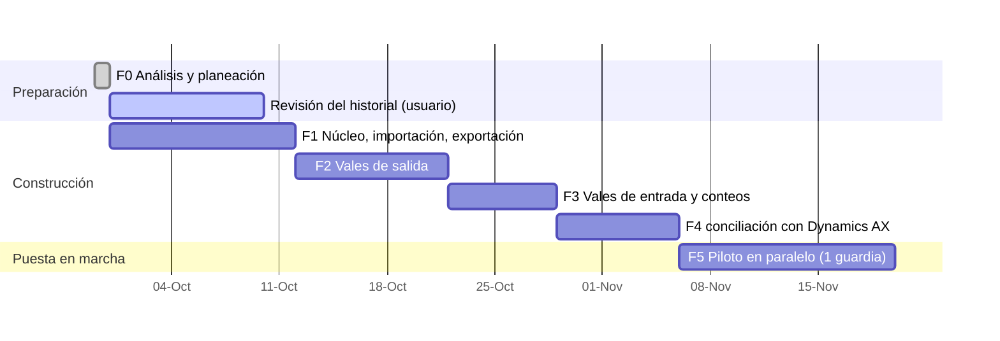

# 08 — Plan de trabajo

Cada fase entrega una **versión nueva de `ControlAlmacen.html`** que el usuario abre en Edge y prueba en su PC (sin instalar nada). No se pasa a la siguiente fase sin que el usuario acepte la anterior.

> Las fechas son orientativas; el avance real depende de las respuestas en [09-pendientes.md](09-pendientes.md).

---

## Fase 0 — Análisis y planeación ✅
- Análisis de los 3 archivos, hallazgos y preguntas.
- Documentación en `docs/`.
- Lista de revisión del historial (`Revision_historial_DLTA.xlsx`, fuera del repositorio).

## Fase 1 — Núcleo de datos, importación y exportación idéntica ✅ (versión web, aceptada)
**Objetivo:** demostrar que la herramienta puede leer los archivos actuales y **reproducirlos idénticos**. Es la base de todo lo demás.

La primera entrega fue de escritorio (Python + instalador). Seguridad de Windows bloqueó el instalador (P-20), así que
F1 se rehízo como **herramienta web que guarda los datos en el equipo** ([03-arquitectura.md](03-arquitectura.md)).
La versión web se validó contra la de escritorio con los archivos reales: mismos datos importados, mismo reporte de
verificación y mismos Excel exportados celda por celda.

Entregables:
- `ControlAlmacen.html` (un solo archivo, ~190 KB en F1; ~300 KB con F2) con datos en IndexedDB y respaldos `.zip` en la carpeta elegida (OneDrive).
- Importadores: catálogo, inventario físico, DIARIO (con reglas de limpieza y lectura de la lista de revisión v2), plantillas por área.
- Exportadores sobre plantilla: inventario `.xlsx` y vales `.xlsm`.
- Respaldo, retención y restauración; copias internas del navegador.
- Pantallas: asistente de primera carga con ensayo, inventario, historial, pendientes, exportar y respaldos.
- Compilación y pruebas en GitHub Actions (artefacto `ControlAlmacen-html`).

Criterios de aceptación (✔ = verificado por el desarrollo con los archivos reales, fuera del repositorio; ☐ = lo verifica el usuario en su PC):
- ✔ En el `.xlsm` exportado solo cambian 2 partes del ZIP (DIARIO y `workbook.xml`); todas las demás (macros, botones, logos, formularios) quedan idénticas byte por byte, incluso comprimidas. LibreOffice lo abre sin errores.
- ✔ Abrirlo en **Excel** y comprobar que **GRABAR / LIMPIAR DATOS siguen funcionando** (confirmado por el usuario).
- ✔ El `.xlsx` exportado conserva hojas, tablas, fórmulas, notas y filas bajo la tabla; LibreOffice recalcula las 1,258 fórmulas sin errores y los totales por hoja coinciden.
- ✔ El reporte de verificación cuadra en 8 de 10 hojas; las 2 diferencias son los vales 550 y 554 que el Excel aún no descontaba (esperado con corte 549).
- ✔ Un respaldo restaurado en otro navegador produce los mismos datos (prueba automática).
- ✔ Abrir `ControlAlmacen.html` en Edge y probar respaldos y restauración (el usuario pidió destacar el respaldo más reciente y hacer más claro el botón *Restaurar*: atendido al inicio de F2).

## Fase 2 — Vales de salida ✅ (aceptada)
Entregables:
- **Nuevo vale** con pestañas (varios borradores que se guardan solos y no gastan folio), plantillas por área y buscador de variantes que muestra la existencia por contenedor.
- Folio automático (último + 1, sin saltos ni cancelaciones) dentro de un cambio atómico; validaciones con mensajes por renglón; justificación cuando se pide más de lo que hay; división en folios consecutivos cuando el vale supera la capacidad del formato (21/20/19 según la hoja).
- **Impresión sobre la hoja-formulario del propio libro de vales** (logo, colores, bordes, anchos, observaciones, firmas, pie de página y escala), tamaño carta, desde el diálogo de Edge (impresora o PDF). Vista previa con `BORRADOR`.
- Detalle del vale con **corrección** (motivo que se llena solo con los cambios, antes → después) en la bitácora. Sin cancelación: todos los folios se usan.
- Descuento automático de existencias. Exportación del DIARIO con los vales nuevos.
- **Por enviar a la base:** lista de vales nuevos o corregidos desde el último envío y botón "Ya lo envié".
- **Traer vales hechos en el Excel** después de la primera carga (así no quedan huecos de folio).
- **Áreas y personas:** edición de plantillas (incluye formato de impresión y lote por defecto), personas, almacenistas y folios.
- Tablero de inicio (siguiente folio, vales de hoy, por enviar, por ubicar, renglones en 0).
- Respaldos: el más reciente se muestra en grande y *Restaurar* es un botón (comentario del usuario sobre F1).

**Ronda de comentarios del usuario (aplicada):** borde derecho del vale impreso igual a los demás; página *Vales de
salida* sin repeticiones de "Nuevo vale" y sin pestañas cuando no hay borradores; datos del vale a la izquierda y
partidas al centro con las columnas del vale; vales internos con origen/destino fijos (`EQUIPO · ALMACEN` → `EQUIPO ·
área`), entregó = almacenista en turno, autorizó solo en transferencias y observaciones fijas donde solo cambia la etapa
de perforación; quién recibe se busca por nombre o puesto; partidas código → clave (filtrada por el código, con
contenedor y existencia en pastillas); borrar partida más claro; contador de partidas en la pestaña; búsqueda rápida
opcional en *Ajustes*; historial con filtros combinables; exportar con ventana "Guardar como".

**Tercera ronda (aplicada):** todas las listas desplegables con el mismo estilo (sin listas nativas del navegador); sin
cancelación ni salto de folios (se quitó "fijar siguiente folio"); motivo de la corrección que se llena solo con los
cambios; Autorizó con puesto y sugerencias RESPONSABLE / ITP; personas mostradas por su puesto (el uso en el área solo
ordena); NOV con datos fijos, 4 firmas y 3 fotos en la posición y tamaño del formato. Pendiente: transferencias (P-22).

**Cuarta ronda (aplicada):** fotos en su propia sección debajo de las partidas; en el panel, origen y destino al
principio (transferencias) y lo que se llena solo al final; encabezado "Presentación" o "U.M." según el espacio. Además,
a propuesta del usuario, *Ajustes → Mi pantalla de vales*: cada almacenista reordena los bloques del panel arrastrándolos
en una vista previa (o con ↑ ↓) y elige de qué lado van los datos y las partidas; se guarda por almacenista. De paso se
corrigió que un cambio hecho menos de un segundo antes de salir de *Vales de salida* no se guardara en el borrador.

Criterios de aceptación (✔ = verificado por el desarrollo; ☐ = lo verifica el usuario):
- ✔ Es imposible duplicar o saltar un folio: prueba automática con 12 emisiones simultáneas y guardado lento (3 con errores que no consumen folio).
- ✔ Recorrido completo en Chromium con los archivos reales (fuera del repositorio): nuevo vale → vista previa → emitir → imprimir → corregir (motivo automático) → dividir → exportar → marcar enviado → traer del Excel → áreas; NOV con 4 firmas y fotos impresas en su lugar; respaldo con fotos; ninguna lista nativa del navegador; sin errores en consola ni conexiones de red.
- ✔ La impresión de las hojas reales se comparó contra el PDF de LibreOffice de la misma hoja: mismo logo, colores, marco, firmas y pie.
- ✔ Imprimir un vale en la impresora del almacén y compararlo con uno hecho en Excel (P-09: el usuario los comparó, "98 % similares").
- ✔ Transferencias: se capturan como están (P-22).
- ☐ Emitir un vale de 10 renglones en menos de 2 minutos.
- ☐ El DIARIO exportado es aceptado por la base sin comentarios (prueba real de un envío).

## Fase 3 — Vales de entrada y conteos ✅ (entregada, en aceptación)

**Ronda de comentarios (aplicada, ronda 5):** descartar un borrador ofrece *Deshacer*; la clave es la dimensión tal cual
y el NP va en el LOTE; en entradas se dice "partida", sin motivo ni depto. origen (solo "viene de"); hoja de conteo con
renglones altos y uniformes para escribir; captura desde foto/PDF con Copilot (copiar instrucciones y pegar el JSON) en
entradas y conteo; reporte diario con imágenes PNG de los vales del día, PDF, libro de vales y *Subir al SharePoint* con
botón de completado; menú corto con íconos y ventana *Ajustes y más*; inicio tipo bento con accesos grandes.

**Ronda 6 (aplicada):** el **reporte diario** entrega el libro de vales y el inventario **al cierre del día elegido**
(no imágenes; se quitó el PNG) y *Ya lo subí* marca solo hasta ese folio; **vales de entrada** rediseñados: elegir
*Captura manual* o *Desde foto o PDF* (guía de 3 pasos, se carga al pegar, el JSON roto se repara solo), barra fija
con *Registrar* / *Descartar* y los pendientes, partidas en tarjetas de dos líneas con *Entra a* y *hay → queda*, sin el
subrenglón de "variante nueva" (la clave escrita es la dimensión), y **Solicita** por partida (LOTE, también en el
JSON de Copilot); **Ajustes y más** como vista en primer plano (secciones | contenido, se cierra con clic fuera, ✕ o
Esc); **personalización** por almacenista: tema claro/oscuro/como Windows, avisos arriba o abajo y animaciones;
animaciones suaves y hover discreto en el inicio.

**Ronda 7 (aplicada):** *Ajustes y más* casi a pantalla completa (la vista previa de *Mi pantalla de vales* ya cabe y,
si la ventana es angosta, las partidas pasan abajo); en el inicio, el bento de *Inventario* cambia por **Etapa de
perforación** (se ve y se cambia ahí), *Crear un vale* oscurece su propio azul al pasar el mouse y *Crear reporte
diario* ya no lleva fecha: el **Reporte diario** queda en el menú después de *Conteo físico*; en el reporte, cada
archivo dice **Descargar** y muestra *✓ Descargado* con el nombre del archivo.

**Ronda 8 (aplicada):** en vales de entrada, campo **NP** por partida (y el NP que venga dentro de la clave se pasa
solo a su campo); los indicadores de la barra (*pendientes*, *por revisar*, *con clave nueva*) **filtran** las partidas
que requieren atención; captura con Copilot con botón **Pegar** y transición suave (*✓ Listo* → partidas que entran una
tras otra). En *Áreas y personas*, **unificar nombres repetidos** (sugeridos o marcados a mano) sin tocar los vales.

Entregables:
- **Vales de entrada** en pestañas (borradores que se guardan solos): folio de la base, de dónde viene, quién entrega;
  por renglón código → clave con el contenedor sugerido (el de más existencia, ★), "Entra a" para cambiarlo, variante
  nueva con aviso de parecidas, *Sin existencia* para diésel y gases. Vista previa por partida (había,
  entra, queda, hoja). Folio interno consecutivo `E-0001`; corrección con motivo automático y bitácora; aviso de folio de
  la base repetido. Devoluciones que regresan al renglón de donde salió el material (P-08).
- **Historial** con pestañas Salidas / Entradas (filtros por fecha, folio de la base, código, O.C. y texto) y
  exportación de `VALES DE ENTRADA <inventario>.xlsx` (columnas del DIARIO + folio interno).
- **Conteo físico** total o por contenedor: hoja de conteo imprimible a ciegas, captura que se guarda sola, diferencias
  contra el sistema, material encontrado, aviso de vales emitidos durante el conteo, historial de conteos.
- **Mover entre contenedores** desde *Inventario*, con historial.
- Estado formato 5 (se migra solo); cada renglón del inventario descuenta desde su propio conteo.
- (El vale de la base llega en papel, P-04: se captura. La lectura por OCR queda como mejora futura.)

Criterios de aceptación (✔ = verificado por el desarrollo; ☐ = lo verifica el usuario):
- ✔ Una entrada de material nuevo queda en la hoja/contenedor correcto del Excel exportado (prueba automática: al final
  de la tabla de esa hoja, con INGRESO, fórmulas y fila de totales; las demás hojas no cambian; código nuevo en `ARTICULOS_MX`).
- ✔ Un conteo parcial reinicia CONSUMO/INGRESO solo en las ubicaciones contadas (prueba automática y en el inventario exportado).
- ✔ Recorrido en Chromium: entrada con sugerido, variante nueva y sin existencia → corrección → historial → mover →
  conteo parcial y total con material encontrado → devolución → exportaciones → respaldo; datos de la versión anterior
  abiertos con la nueva; sin errores en consola ni conexiones de red.
- ☐ Registrar una entrada real y revisar el inventario exportado.
- ☐ Hacer un conteo (aunque sea de un contenedor) con la hoja impresa.

## Fase 4 — Conciliación con Dynamics AX ✅ (entregada, en aceptación)
Entregables:
- Importación del reporte AX (completo o filtrado) con historial de cortes.
- Emparejamiento en tres niveles con memoria de equivalencias.
- Vistas por artículo, por contenedor y valuadas, con vales en tránsito.
- Exportación de la solicitud de ajuste (AX + Existencia física + Folios).

**Ronda 9 (aplicada):** solo se concilia el modelo **INV**; *Por confirmar* **corrige la dimensión / NP del
inventario** a como está en AX (con *Deshacer*), sin memoria aparte; la página es un **bento (masonry)** cuyos mosaicos
abren cada sección en una ventana en primer plano con buscador; la solicitud de ajuste lleva columna *Estado* y la fila
coloreada. Además: fecha del encabezado de página del inventario = día del reporte, descarga más robusta (reintenta,
verifica y, si no se puede escribir donde se eligió, descarga a *Descargas* con el motivo), ▶ del reporte llega a hoy,
**Alt + N** agrega una partida en vales de salida y de entrada, el botón *Copilot* se oculta durante la guía, editar
dimensión y NP desde *Inventario* (con sugerencias de AX), "partida" en lugar de "renglón" en la interfaz y bentos con
acomodo masonry.

**Ronda 10 (aplicada):** en AX **Tamaño + Color = la dimensión** (AX no trae NP): la corrección y las sugerencias ya no
mandan el Color al NP; la **solicitud de ajuste** va primero y destacada (con cuántas partidas lleva); el reporte diario
ya no encima sus secciones; el botón *Quitar* de los vales de salida se colorea completo; revisión general (contraste en
tema oscuro, foco visible, menú en una línea, filtros del historial, pestañas "Borrador N"); y *Ayuda → Abrirla como
aplicación* (acceso directo de Edge en ventana propia).

**Ronda 11 (aplicada):** en *Por confirmar*, las partidas del inventario que ya son pareja de otra partida de AX no se
sugieren ni aparecen en *Otra…* (antes se podía asignar la misma a varias); se avisa cuántas se ocultan y, si no queda
ninguna libre, se propone *No está en el físico*.

**Ronda 12 (aplicada):** el **archivo de vales de la base** (su copia del DIARIO con INV/NINV, TIPO DE MOV, CANTIDAD
aplicada, TR, IN y COMENTARIOS) se importa en *conciliación con Dynamics AX*: cada partida de los vales sabe si ya está en AX (folio
IN / TR), si está pendiente (INV sin folio, o lo que falta de una aplicación parcial) o si no se descuenta (NO INV,
CONPROV). Lo pendiente cuenta como tránsito aunque el vale sea anterior al corte; NO INV no justifica diferencias. Avisos
de diferencias entre la base y los vales; aviso cuando la base y AX son de días distintos (se usaba el archivo de fecha más
cercana; la Ronda 13 lo simplificó). Columna *AX* y filtro *Revisar* en el historial y en el detalle del vale. **Partidas
duplicadas** dentro de un vale (el formulario de Excel guardaba el vale dos veces): se marcan, se filtran y se quitan
con una corrección con el motivo escrito. Estado formato 7 (`seguimientos_base`).

**Ronda 13 (aplicada):** la **fecha del archivo de la base ya no importa** (no se pide; se guarda solo el último): lo
que no tiene folio IN / TR justifica faltantes aunque el vale sea anterior al corte (también lo sin revisar, lo que la
base no tiene y los vales posteriores a su archivo); la fecha que importa es la del reporte de AX. **Vista *Todos* =
kardex completo** (antes faltaban las partidas por confirmar y las que no están en el físico): mosaico *Todo el reporte
de AX*, filtro *Por confirmar* con *Confirmar…* y casilla para incluir lo que solo está en el físico.

**Ronda 14 (aplicada):** **justificar faltantes con vales**: a cada faltante se le asignan los vales que ya salieron y
que AX aún no descuenta (sin IN / TR), sin importar su fecha; se sugieren por código, dimensión y cantidad y se aprueban
una por una o todas, o se eligen a mano (con *Deshacer* y *Quitar*). La solicitud de ajuste trae ahora la hoja **LEYENDA**
al principio (colores, (S) = salida, (E) = entrada, marcas de los folios), la hoja de AX igual y **VALES POR APLICAR**
para que la base registre esas partidas; las entradas se citan con el **folio del vale de la base**. La pantalla se
reorganizó: bento con lo que se hace (*Enviar a la base*, *Por resolver*: emparejar y justificar, *Diferencias contra AX*,
*Reporte AX*, *Consumos de la base*) y una columna de *Resumen* que solo informa. Estado formato 8 (`corte.asignaciones`).

**Ronda 15 (aplicada):** **partidas de AX sin dimensión** (Tamaño y Color vacíos): se comparan contra todas las
variantes del código que tampoco tienen dimensión (S/D, SIN DIMENSIÓN, S/N… con distintos NP), o contra el código
completo si es su única partida en AX. Antes emparejaba con una sola variante (por ejemplo la que tenía 0) y el resto
quedaba "solo en el físico". La fila muestra "Todo el código (N variantes)" o "Sin dimensión (N variantes)" con lo que
hay en cada una; en AX se lee *SIN DIMENSIÓN*.

**Ronda 16 (aplicada):** **inventario diario**: CONSUMO e INGRESO se "limpian" al pasar el día, como en el Excel del
almacén. La página *Inventario*, el inventario exportado y el del reporte diario muestran CANTIDAD = lo que había al
empezar el día y CONSUMO / INGRESO = solo los vales de ese día (antes se acumulaban desde el conteo, por eso un consumo
de días atrás seguía apareciendo). El TOTAL y lo guardado no cambian.

**Ronda 17 (aplicada):** **dos inventarios, Inventario A y Inventario B, por separado** (mismos tipos de archivo: vales de salida,
inventario, reporte de AX y archivo de la base). Selector en la cabecera con un color por inventario; cada uno con su base
en el navegador, folios, plantillas, respaldos (`almacen_<inventario>_…` para Inventario B), carpeta, reporte diario y conciliación; formato
9 (`config.inventario`). Nombres con el inventario: `VALES DE ENTRADA <inventario>.xlsx`, `SOLICITUD DE AJUSTE Inventario B
DDMMAA.xlsx`. Aviso al elegir un archivo cuyo nombre dice el otro inventario; un respaldo no se restaura en el otro.
**Vale impreso por inventario** (*Ajustes*): se imprime con los textos y logos del libro de vales cargado; el encabezado
del archivo aparece editable (p. ej. el nombre del almacén «MX Inventario A …» y la dirección para Inventario B), reemplazos en todo el
formato y cambio de logos, con vista previa por hoja. No cambia el Excel ni los vales.
- ☐ Hacer la primera carga de Inventario B con sus archivos y revisar que Inventario A sigue igual.

**Ronda 18 (aplicada):** en Inventario B **toda la interfaz** toma el morado (botones, enlaces, menú, pestañas, foco; claro y
oscuro). **Etapa de perforación compartida** entre Inventario A y Inventario B (base común; se adopta al abrir, cargar o restaurar).
*Vale impreso*: dice que los textos y logos valen para todas las hojas. **Vale impreso más fiel:** bordes negros nítidos
con su grosor (1 px fino, 2 px el marco) y sin rendijas entre celdas de color al escalar la hoja; «RECIBIO/ENTREGO» centrado
sobre el nombre y el puesto (en el formato era una celda suelta alineada a la izquierda); las filas espaciadoras no
imprimen su texto.
- ☐ Imprimir un vale y revisar bordes y títulos de firma contra el de papel.

**Ronda 19 (aplicada):** **quitar áreas** en *Áreas y personas*: *Quitar…* borra el área que ningún vale ni borrador usa
(con *Deshacer*) y descarta la que tiene vales (deja de salir al hacer vales; se recupera desde *Áreas descartadas*).
**Personalización, captura de partidas y Mi pantalla de vales** son las mismas en Inventario A y Inventario B (como la etapa): el tema
oscuro elegido en Inventario B también queda en Inventario A.
- ☐ Revisar el vale impreso de Inventario B (textos y logo) contra uno en papel.

**Ronda 20 (aplicada, no es de una fase):** el **generador de etiquetas** dentro de la herramienta (menú *Etiquetas*,
`docs/11-etiquetas.md`). Al registrar una entrada se sugiere hacer sus etiquetas (una por pieza); en la sección se agregan
de un vale de entrada (por folio interno o de la base), del inventario, a mano o desde la lista `.json` del generador
(que sigue para el teléfono). *Condición* pasa a *Inventario* (Inventario A / Inventario B, editable); NOMBRE = el de AX si lo trae el
reporte; ÁREA vacía; DESCRIPCIÓN = la O.C. Logos propuestos del libro de vales. Las impresas quedan en la bitácora y
marcan la entrada (historial con filtro *Etiquetas*). Estado formato 10.
- ✔ Propuestas, lista, bitácora, lista del generador, migración y cuadrícula (pruebas `tests/etiquetas.test.js`).
- ✔ Recorrido en Chromium: entrada → sugerencia → imprimir → *Salieron bien*; inventario, a mano, `.json`, diseño (J-5163),
  logos del vale y subidos, código AX, historial y detalle; sin errores ni peticiones de red; tema oscuro y pantalla
  angosta. PDF de cada plantilla con las hojas exactas.
- ☐ Imprimir una hoja real (carta 2 × 6 y precortada J-5163) y comparar con lo que daba el generador.
- ☐ Elegir los logos del vale para Inventario A y Inventario B y revisar que se vean bien en la etiqueta.
- ☐ Contestar P-25 a P-28 (`docs/11`).

**Ronda 21 (aplicada):** etiquetas de **Inventario A y Inventario B en una sola impresión** (`docs/11`): la lista por imprimir y la bitácora
son las mismas en los dos inventarios; en *Del inventario* y *De un vale de entrada* se eligen los **datos de Inventario A o Inventario B**
sin cambiar de inventario (el otro solo se lee); las ventanas ya no obligan a hacer scroll para ver los botones. Estado
formato 11.
- ✔ Pruebas: compartir la lista y la bitácora con la base común (también atrasada), migración 10 → 11, marcas por
  inventario e ids sin choques.
- ✔ Recorrido en Chromium (1366 × 768): Inventario B trae material de Inventario A, la lista sigue al cambiar a Inventario A, se imprime junto y
  cada entrada queda marcada en su inventario; botones a la vista; sin errores ni peticiones de red.
- ✔ Revisión adversarial (4 revisores + verificadores): restaurar ya no pasa marcas a otra entrada, no se vuelve a juntar
  una lista vieja, ids y bitácora sin choques, reloj atrasado, ventanas en pantallas angostas y marcas de las dos
  fuentes en *Del inventario* (pruebas nuevas en `tests/compartidos.test.js` y `tests/etiquetas.test.js`).
- ☐ Armar una hoja con material de los dos inventarios en el almacén y revisar que cada etiqueta lleve su logo.

**Ronda 22 (planeada, sin implementar):** fecha del vale y **fecha de recibido** en las entradas (la de recibido decide
el día del inventario y del reporte diario) y **editor libre de diseños de etiquetas** con texto libre, QR y código de
barras. Decisiones y pasos en `docs/12-ronda-22-plan.md`.

**Ronda 23 — etapa 0 de la rutina de auditoría (aplicada): base oficial con el conteo de la auditoría.** Primero las
bases: el conteo del Kardex de la auditoría como CANTIDAD de lo **inventariable** (lo consumible no se toca), con vista
previa por secciones (se escriben distinto, cambian con su impacto en $, repetidas que se dan de baja, nuevas en el
contenedor que anotó el conteo, solo en consumible, inventariables sin Kardex con *No existe*). **FX dentro del
Inventario B** (comparte vales y folios): el conteo marca sus partidas; en *Inventario* se ven y se filtran; su **libro de
Excel aparte** (exportar y reporte diario). **Aviso de Kardex equivocado** en la base oficial y en la conciliación
(códigos que no son del inventario, hoja de otro inventario; un libro con varias hojas ya no toma "la primera"; la
Ronda 24 lo quitó: el usuario une las hojas). Probado
en local con los archivos reales (sin subirlos): aplicar dos veces el mismo Kardex no cambia nada.
- ☐ Cargar el Kardex de la auditoría en los dos inventarios, revisar la vista previa y aplicar.
- ☐ Exportar el inventario del Inventario B y el de FX y compararlos con el Kardex.
- Siguiente (cuando el inventario quede correcto): marca FX en vales y entradas (LOTE automático), alertas de repetidas
  y de "recibido sin registrar", conteo guiado por el Kardex, resumen de guardia y Kardex esperado.

**Ronda 24 — el Kardex reemplaza lo inventariable (aplicada).** Decisiones del usuario: **unir hojas e inventarios** a
mano, como el juego de parejas (Inventario A, Inventario B y FX contra las hojas de uno o varios archivos), sin revisar
códigos; el Kardex **reemplaza** lo inventariable en lugar de emparejar uno a uno: lo idéntico se queda con su NP, lo
demás sale del Kardex (lo que AX cuenta junto queda en una partida, como las botoneras sin dimensión) y lo que no viene
en el Kardex se da de baja. **Listas de revisión** impresas: NP que se pierden y lo que sale del inventario (se guardan
con el conteo). **NP editable** desde *Inventario* (lápiz, con los NP anteriores como sugerencia). **Códigos de 3
dígitos** en el Inventario B y FX = siempre consumibles (también en entradas y conteos); en el Inventario A no aplica.
Lo consumible no se toca. Probado en local con los archivos reales (sin subirlos).
- ☐ Unir las hojas del Kardex, revisar las listas impresas y aplicar en los dos inventarios.
- ☐ Anotar los NP que hagan falta y revisar en físico lo que salió.

Hecho: página *conciliación con Dynamics AX* (menú, después de *Reporte diario*): importar el corte con vista previa (almacén, fecha
del nombre, folio de corte opcional, aviso si el archivo ya se importó); resumen (emparejado %, cuadran, sin explicar
con valor, solicitud de ajuste); *Por confirmar* con *Es esta* / otra / *No está en el físico* y *Confirmar las seguras*;
vistas por renglón de AX, por artículo, por contenedor y valuada con filtros; listas sin pareja; exportación
`SOLICITUD DE AJUSTE DDMMAA.xlsx`. Estado formato 6 (`cortes_ax`, `equivalencias_ax`).

Criterios de aceptación (✔ = verificado por el desarrollo; ☐ = lo verifica el usuario):
- ✔ Con el corte sintético, 92 % queda emparejado solo; tras una sesión de confirmación (que corrige el inventario), 100 %, y el segundo corte empareja exacto sin preguntar (prueba automática).
- ✔ Cada diferencia muestra los folios que la explican (salidas y entradas en tránsito), o queda como sobrante / faltante sin explicar con su valor (prueba automática y en pantalla).
- ☐ Con el corte real (`REPORTE DE EXISTENCIAS <fecha>.xlsx`): al menos 95 % emparejado tras una sesión de confirmación.
- ☐ Revisar con la base que la solicitud de ajuste se entienda igual que el reporte de AX.
- ✔ Con el archivo de la base sintético, cada partida queda aplicada / parcial / pendiente / NO INV / sin revisar como
  dice la base, lo pendiente explica diferencias como tránsito y las duplicadas se quitan con una corrección (pruebas
  automáticas y en pantalla).
- ✔ La vista *Todos* trae cada partida INV del reporte de AX (también por confirmar y sin físico) y cada mosaico cuenta
  lo mismo que su filtro (prueba automática y en pantalla).
- ☐ Importar un archivo de la base con todos los vales hasta la fecha del reporte de AX y revisar los avisos y las duplicadas.
- ✔ Un faltante se justifica asignándole vales (sugeridos y aprobados, o a mano); lo asignado explica la diferencia y sale
  en *VALES POR APLICAR*; la solicitud abre con su *LEYENDA* (pruebas automáticas y en pantalla).
- ☐ Revisar con la base que *VALES POR APLICAR* y la *LEYENDA* se entiendan.

## Fase 5 — Piloto en paralelo y cierre
- Durante **una guardia completa (~14 días)** se trabaja con la herramienta y se siguen enviando los Excel exportados. La base no debe notar diferencia.
- Manual de usuario de 1–2 páginas por flujo (con capturas).
- Ajustes de usabilidad según la experiencia de ambos almacenistas.
- Decisión de adopción completa (a partir de ahí se exporta solo `DIARIO`, RF-64).

---

## Cómo se trabajará en cada fase
1. Rama de trabajo por fase y Pull Request con descripción de cambios.
2. Pruebas automáticas (`node --test`) con Excel **sintéticos** generados por `tests/fixtures/generar.py`. Nunca con datos reales.
3. Al cerrar la fase: `ControlAlmacen.html` nuevo + notas de versión + lista de verificación de aceptación para el usuario.
4. Los datos del usuario pasan de una versión a otra sin hacer nada: se quedan en su navegador (y en sus respaldos).

**Ronda 36 — no abría después de un apagón (fallo reportado).** Tras un corte de luz, una ventana se quedaba en
*Cargando…* para siempre y las demás decían *ya está abierta*, sin salida; reiniciar no lo arreglaba. Causa encontrada:
al abrir se esperaba el respaldo del inicio del día en la carpeta de OneDrive y, al quitar los respaldos viejos, listar
la carpeta no tenía tiempo límite (reproducido en Chromium: con la carpeta sin responder no abría nunca; si lo que no
respondía era escribir, abría al minuto). Aplicado:
- ☑ La herramienta se dibuja en cuanto se leen los datos; el respaldo del día va después, en segundo plano. Todo lo de la
  carpeta tiene tiempo límite (escribir 60 s, listar y borrar 20 s), igual que el permiso, lo compartido y el almacenamiento.
- ☑ La pantalla de carga dice en qué paso va; a los 12 s en un paso ofrece **Recargar**, **Restaurar un respaldo…** y el
  **diagnóstico** (copiar o descargar; el registro anota los pasos que tardan).
- ☑ **Restaurar de emergencia** (pedido del usuario: «borrar los datos y empezar desde un respaldo»): sin abrir la
  herramienta, copia de lo que hay en Descargas (si se puede leer), revisión del respaldo (fecha, hasta qué folio llega y
  qué folios de este equipo se perderían) y restauración solo del inventario abierto. Si la base no responde, se borra y
  se restaura en una nueva; si ni así, la pantalla explica cómo borrarla a mano.
- ☑ **Ya está abierta → Abrir aquí**: la otra ventana suelta sus bases, deja de guardar y lo dice (*Usar esta ventana*
  la recupera).
- ☑ Revisión del usuario (1): ya abre (3–4 s), pero **«Permitir» se quedaba en «Pidiendo permiso…»** y Edge nunca
  mostró su aviso. La forma de pedir el permiso es la misma desde F1 (se revisó el historial); Edge dejó de contestar con
  esa carpeta tras el apagón.
- ☑ Revisión del usuario (2) — «textos cortos, que digan qué hacer» y «que los respaldos funcionen sin depender de
  OneDrive»: **siempre hay respaldo**. Si Edge no contesta en 6 s o niega el permiso, el respaldo del día se descarga
  (*Descargas*). Si nadie pulsa *Permitir* en 2 min, también. El aviso queda en una línea: *Edge no dio acceso a «X».
  Respaldo de hoy en Descargas ✓* con **Elegir carpeta…** (explorador de Windows, que da el permiso en el mismo diálogo).
  Si luego hay permiso, el de hoy también va a la carpeta. Pantallas de arranque y rescate con textos de una línea.
- ☑ Del usuario: volver a elegir la carpeta (en *Respaldos*) hizo que Edge preguntara otra vez el permiso.
- Nota: abierta como archivo (`file://`), Edge no guarda «Permitir en cada visita» al cerrarse; lo pide en cada sesión de
  Edge. Solo una dirección web (opción B de `docs/10`) lo conserva.

**Ronda 35 — correcciones del usuario (vale, inicio, menú, áreas).** Aplicada en 6 etapas en `main`:
- ☑ Menú lateral: sin la barra horizontal del menú de íconos (los botones medían 1 px más que el espacio); con el menú
  completo, DLTA | GSM va arriba, a la izquierda de *Contraer menú* (con el de íconos, en la cabecera).
- ☑ Paso 1: *Consumo interno* / *Transferencia* (RIG y pozo son lo mismo). En transferencias la línea «… PARA USO EN …»
  de las observaciones dice el destino elegido (lo que seguía a «PARA USO EN» se reemplaza; sin esa línea, se agrega
  antes de la etapa). Quién recibe, quién autoriza y las firmas extra salen del **vale más reciente del área** (también
  en transferencias: quién transportó y autorizó la última); sin vales, los de la plantilla.
- ☑ Paso 2: sin *Buscar en*: **Código o descripción** + **Dimensión o NP**. Si la dimensión no está en un código, ese
  código ofrece «Usar «…» en <código>» tal como se escribió (antes se adivinaba qué palabra era la clave y se perdían
  letras que también estaban en la descripción). Cada código es una tarjeta aparte; los atajos se ven como teclas.
- ☑ Paso 3: sin lista de pendientes arriba: lo que falta se marca en ámbar en su fila (*Para quién*, cada partida, las
  fotos). Tabla: Cantidad · Código y descripción · Dimensión con «NP:», «Lote:» y «O.C.:» a su lado.
- ☑ Inicio sin datos: dos caminos (*Empezar desde cero* / *Seguir desde un respaldo*), primero la carpeta de trabajo
  (explorador o arrastrar) y luego la primera carga **un paso a la vez** (pasa sola al tener los dos Excel y ensaya sola
  al llegar a *Revisar y cargar*), con Regresar / Continuar en grande. El menú sin datos solo lleva a Inicio. Sin textos
  de privacidad.
- ☑ Áreas: solo **tres plantillas** (Consumo interno, NOV, Transferencia) con su formato y observaciones en un lugar;
  *Áreas y destinos* en una lista (nombre + plantilla); los de Transferencia son los destinos de «¿A dónde se envía?» y
  se pueden agregar (compartidos entre DLTA y GSM).
- ☑ Revisión del usuario (1): la justificación de lo que sale de más se escribe en el **paso 2**, debajo de la partida
  (en el paso 3 ya no cabía): Tab desde la cantidad entra a ella; el paso 3 solo la muestra («Justificación: …») o, si
  falta, avisa en su fila con «Ir a la partida», que lleva al campo. En la primera carga y la bienvenida, un solo botón
  va al centro y, si los dos no caben lado a lado, cada uno va a todo lo ancho (el principal arriba). En *Áreas y
  destinos*, el departamento de un RIG es su nombre (solo en la lista: el vale sigue con el de la plantilla).
- ☐ Revisión del usuario: que «PARA USO EN <destino>» sea el texto que espera con su libro real; que sugerir a quien
  transportó la última transferencia le sirva; la primera carga paso a paso con sus archivos.
- ☑ Áreas al importar (pedido del usuario): en la primera carga, un paso **Áreas** (entre *Archivos* y *Conteo base*)
  con las hojas del libro de vales (menos DIARIO) como pastillas en tres frascos — Consumo interno, NOV, Transferencia —
  que se arrastran; con clic se renombran (sin repetir), cambian de plantilla o se quitan, y se dice que se cambia
  después en *Áreas y personas*. Decisiones: de Transferencia, la de TRANSFER… (o la primera, o la que se marque) es el
  formato y las demás se agregan a los destinos (además de los de fábrica); una hoja quitada queda como área
  descartada (sus vales del DIARIO se siguen imprimiendo con ella); un destino quitado no se agrega.
- ☑ Avisos que salen con animación (pedido del usuario, con video): al cerrarse o vencer, un aviso de la pila se
  desvanece y se encoge mientras su lugar se cierra poco a poco (0.34 s), así los demás se recorren en lugar de brincar;
  igual con los avisos abajo. El cuarto aviso saca al más viejo con la misma animación. Sin animaciones (personalización)
  o con *Reducir movimiento* de Windows, se quita de una vez.
- Siguiente (lo dirá el usuario; no empezar sin su luz verde): que un nuevo comienzo reconozca el costo; mejorar
  *Revisar y cargar* de la primera carga cuando hay diferencias.

**Ronda 34 — rediseño del vale de salida en 3 pasos** (en curso, en `main`). Especificación:
`docs/13-rediseno-vale-salida.md`; diseño aprobado: `docs/diseno/ronda-34/`. Se entrega por etapas (§13) y el usuario
revisa cada una con sus capturas a 1440, 1024, 768 y 640 px antes de seguir.
- ☑ Etapa 1: el borrador guarda su paso; indicador de pasos; la página repartida en *Para quién*, *Material* y
  *Revisar y emitir* con el editor de antes por dentro; *Descartar borrador* en la franja de pestañas.
- ☑ Etapa 2: paso 1 completo (interno, transferencia, firmas extra). Decisiones del usuario: sin área preseleccionada;
  destinos RIG 48, 90, 165, 256, BASE IXACHI y BASE MARIN (el RIG propio no); al cambiar entre consumo y transferencia
  se elige de nuevo el área o el destino; Enter en el paso 3 emite con confirmación.
- ☑ Etapa 3: paso 2 — buscador, resultados y lista con scroll propio. Decisiones del usuario: el NP se muestra como
  referencia y ya no llena el LOTE, salvo con el ajuste *NP en el lote* (apagado por omisión, igual en los dos
  inventarios); cada partida lleva Lote y O.C.; la UM se escribe solo en lo que no sale del inventario; «Buscar en» con
  la lista propia (sin `<select>`).
- ☑ Etapa 4: paso 2 — editar partida, clave nueva, código nuevo, traer partidas. Con la revisión del usuario: Para
  quién y Partidas en tarjetas separadas; lote y O.C. solo al editar (en letra chica si tienen); un solo botón *Editar*
  y la partida elegida se edita a la izquierda (sin lápiz por partida); la búsqueda se conserva y tiene ✕ para limpiarla;
  el material de FX lleva LOTE «FX» por omisión; los títulos de las firmas de NOV son solo de pantalla.
- ☑ Etapa 5: paso 3 — pendientes (con *Ir a la partida*, la justificación ahí mismo y *Corregir*), resumen, vista
  previa real (el mismo HTML de impresión) y ampliada con zoom; *Emitir* bloqueado mientras falte algo (también las
  fotos de NOV). Decisión del usuario: lote y O.C. en el resumen solo si tienen algo. Desde esta etapa se trabaja en
  `main` (las 1–4 se fusionaron ahí).
- ☑ Etapa 6: menú lateral y anchos de ventana. Menú completo (236 px, *Contraer menú* de 36 × 36 arriba) o de íconos
  (64 px, botones de 44 × 44 y el pendiente como punto ámbar, con el número en el nombre del enlace); **Ctrl + B**
  alterna; por debajo de 1280 px siempre íconos y *Expandir menú* lo abre encima del contenido (Esc, clic fuera o elegir
  una sección lo cierran); ya no hay barra inferior ni ventana *Todas las secciones*; nunca se abre ni se cierra solo.
  La lista del vale en < 700 px y *Emitir* se acomodan al menú de íconos. Capturas a 1440, 1024, 768 y 640 px sin
  desbordes (`tests/valePasos.navegador.mjs`, `tests/navegacionAdaptable.navegador.mjs`).
- ☑ Etapa 7: limpieza y documentación. Se quitaron *Mi pantalla de vales* y *Captura de partidas* de *Ajustes* (con su
  código, estilos y pruebas); `migrarEstado` borra `config.preferencias_vale` y `config.captura_rapida` al cargar (sin
  subir el formato) y la base común las ignora. `EditorVale` (corrección de vales emitidos) arma sus datos en un orden
  fijo. Flujos, guía de uso, arquitectura y modelo de datos describen el vale en 3 pasos. También: por debajo de 1280 px
  la columna del menú es de íconos desde el CSS, para que en el cuadro en que la ventana cambia de tamaño el menú
  completo no empuje el contenido fuera (la prueba `comentarios` lo atrapaba de vez en cuando a 390 px).

**Ronda 33 — vale de salida a partir de otro vale.** Pedido del usuario: el material que se recibe y se entrega el mismo
día ya está capturado en su entrada; volver a escribir las partidas en el vale de salida es doble trabajo. **Aplicado:**
*Vale de salida* en el detalle de la entrada, *Desde un vale…* en *Vales de salida* (ventana con lo recibido hoy primero y
búsqueda por folio de entrada, de la base o de salida) y la opción en el menú del historial y del detalle del vale de
salida (*Copiar a un vale nuevo*, que además repite área y personas). Crea un borrador (no gasta folio): cada partida sale
de la partida del inventario a la que entró, con cantidad y O.C.; LOTE = NP. Ver docs/05 §1. `servicios/copiarVale.js`,
`ui/paginas/copiarVale.js`; pruebas `tests/copiarVale.test.js` y Chromium `tests/copiarVale.navegador.mjs`. El borrador
guarda `copia_de` (opcional, no cambia el formato del estado; el vale emitido no lo lleva, solo la bitácora).
- ☐ Del usuario: registrar una entrada real, hacer su vale de salida con *Vale de salida* y revisar el impreso.

**Ronda 32 — el inventario del Inventario B y el de FX salían «con errores» que Excel reparaba.** Con las carpetas ya
fijadas (arrastrando, el registro mostró que el explorador de Edge responde `AbortError` aunque se elija), los cinco
archivos quedaron en su lugar; al abrirlos, Excel reparó el inventario del Inventario B y el de FX («Fórmula quitada»
en cuatro hojas, «Tabla reparada» y, en FX, «Parte quitada» de cinco tablas). Los del Inventario A y los libros de vales,
bien. **Causas** (reproducidas con datos inventados): las hojas sin partidas de FX dejaban su tabla sin filas de datos
(Excel la quita) y lo de debajo de la tabla —fórmulas de rango, combinadas, validaciones, formatos— se copiaba en lugar
de reubicarse (`SUBTOTAL(109,F2:F5)` con 2 partidas quedaba `F0:F3`). **Aplicado:** tabla vacía con una fila en blanco y
reubicación como Excel al insertar o borrar filas (docs/06). Pruebas `tests/inventarioTablas.test.js` con un pie
sintético en la plantilla de GSM (`pie_con_formulas` en `generar.py`).
- ☐ Del usuario: guardar otra vez el inventario de GSM y el de FX y abrirlos en Excel (si aún repara, mandar el registro de
  Excel y, si se puede, el archivo antes de abrirlo; se revisa solo aquí y nunca se sube).

**Ronda 31 — elegir la carpeta o el libro de vales «no hacía nada».** Reporte del usuario: en *Carpetas…*, al elegir
la carpeta base en el explorador o el libro de vales, no pasaba nada (tampoco tras recargar), y *Descargar* seguía
abriendo «Guardar como». No se reproduce aquí; la única forma en que eso queda en silencio es que Edge responda como al
cancelar (`AbortError`) aunque se eligió, como «Guardar como» en la carpeta de OneDrive (Rondas 26 y 29). **Aplicado:**
nunca en silencio (dentro de la ventana y en un aviso, con lo que respondió Edge); si Edge no responde 5 s después de
cerrarse el explorador, se dice, y si responde después se usa lo elegido; la base se guarda antes de buscar adentro (y la
búsqueda tiene límite de tiempo); **arrastrar desde el Explorador de Windows** la carpeta base, la de cada inventario o el
libro de vales (no pasa por el diálogo de Edge); y un **registro** (sugerencia del usuario) de lo que pidió la herramienta
y lo que respondió Edge en cada paso, que se copia o descarga desde *Carpetas…* para pegarlo en la conversación.
- ☐ Del usuario: volver a fijar las carpetas (elegir o arrastrar) y, si algo falla, mandar el registro.

**Ronda 30 — el reporte diario guarda cada archivo en su carpeta.** Pedido del usuario: «Guardar como» en OneDrive no
funcionaba bien y los archivos siempre van al mismo lugar: el libro de vales de salida, en el Escritorio (se reemplaza); el
inventario, en `<inventario>/<carpeta de inventarios>/<año>/<mes>/` dentro de la carpeta del inventario diario (el de FX sin
carpeta de inventarios). Debe pasar **solo al pulsar Descargar** (nada automático), con las carpetas configurables y
pensando en días anteriores. **Aplicado:** *Reporte diario → Carpetas…* (también en *Ajustes*): una **carpeta base**
(Edge no deja elegir el Escritorio ni las que lo contienen, como todo OneDrive) con la **ruta de cada inventario y de FX**
(`{año}`, `{mes}`, `{mm}`, `{nombre_mes}`; se proponen solas buscando las carpetas de cada inventario y la forma de mes que ya
se usa; **Explorar…** la toma del explorador) y el **libro de vales de cada inventario** como archivo fijo. Se guarda en la
base común (lo mismo en los dos inventarios, de este equipo, fuera de los respaldos; sin cambio de formato del estado).
*Descargar*: pide el permiso dentro del clic, encuentra las carpetas aunque se escriban distinto (`05.MAYO` = `05. MAYO`),
crea la del mes o el año que falte (nunca una fija), pregunta antes de reemplazar el inventario de ese día (o el libro de vales
si deja fuera vales posteriores), y si no se puede escribir va a Descargas con la ventana de siempre; el archivo nuevo que no se
pudo escribir no se queda vacío. Cada tarjeta dice a qué carpeta va y tiene **Guardar como…** para otro lugar esa vez. Sin
carpeta fijada, todo sigue como antes. *Exportar y enviar* sigue con «Guardar como». Pruebas `tests/destinos.test.js` y Chromium
`tests/destinos.navegador.mjs`.
- ☐ Del usuario: fijar las carpetas en su equipo y guardar el reporte de un día y el de un día anterior.

**Ronda 29 — «Guardar como» que no hacía nada (reporte diario).** Reporte con grabación: al pulsar *Guardar* en la
carpeta del inventario diario de OneDrive no aparecía «Generando Excel…» ni el archivo; guardando en otra carpeta sí, y
otra vez inmediatamente, no. Mientras tanto OneDrive subía `almacen_…_exportacion.zip` (6.8 MB): cada exportación hacía
un respaldo completo en la carpeta de OneDrive, y el reporte diario exporta dos libros seguidos. Cuando Edge no puede
usar la carpeta responde igual que al cancelar (o no responde), y la herramienta se quedaba callada. **Aplicado:** el
respaldo al exportar solo si el último tiene más de 4 horas; si «Guardar como» se cierra sin archivo, aviso *No se
guardó…* con **Guardar en Descargas**; si Edge no responde 5 s después de cerrarse el diálogo, se guarda en Descargas y
la ventana con dibujos muestra a OneDrive subiendo (si Edge responde después, también se guarda en el archivo elegido);
lo que no quedó donde se eligió va a Descargas (en el equipo, sin OneDrive); las escrituras tienen límite de tiempo.
- ☐ Del usuario: probar el reporte diario de los dos libros seguidos en la carpeta de OneDrive.
- ✔ Propuesta: guardar el reporte directo en su carpeta (elegirla una vez; año y mes solos), sin «Guardar como» → Ronda 30.

**Ronda 28 — revisión de FX.** Lo que ya hace: el conteo de auditoría marca las partidas de FX; *Inventario* las muestra
y las filtra; *Exportar* y el *Reporte diario* sacan el libro de FX aparte (y el del Inventario B sin ellas); la
conciliación del Inventario B no las cuenta. **Corregido:** mover material de FX a otro contenedor lo volvía del Inventario
B (o lo sumaba a la partida del Inventario B); una entrada o lo encontrado en un conteo se podía sumar solo a una partida
de FX del mismo contenedor; al justificar faltantes del Inventario B se ofrecían salidas de partidas de FX. Ahora
`renglonDe` / `crearRenglon` respetan el dueño y la pastilla **FX** se ve al elegir la clave en vales y entradas, en la
captura del conteo y en la hoja de conteo impresa (`tests/fx.test.js`). Pendiente, por decidir (docs/09):
- ☐ P-26: LOTE de las partidas de FX en los vales (hoy sale el NP; la base no sabe que es FX).
- ☐ P-29: cómo se reconocen las entradas de FX.
- ☐ P-30: marcar / desmarcar FX a mano en *Inventario*.
- ☐ P-31: conciliación de FX con AX (con qué archivo y almacén).
- ☐ P-32: qué dice la etiqueta de una partida de FX.
- ☐ Del usuario: cargar el Kardex de auditoría, exportar los libros del Inventario B y de FX y compararlos con el Kardex.

**Ronda 27 — avisos que se entiendan.** Reporte diario: ◀ ▶ van de un día en un día (antes saltaban al día
con vales). Avisos: como las notificaciones de iOS / Android (arriba al centro, ícono del tipo en un cuadro de
color, título corto —Listo, Atención, No se pudo, Aviso—, el detalle debajo, acciones como botones), botón redondo
de 40 px para cerrar, barra del tiempo que les queda y pausa mientras el mouse o el teclado están encima. Cuando el
Excel no quedó donde se eligió: ventana al centro con dibujos propios de Windows 11 (barra de tareas con Excel
abierto y la ✕ de su vista previa; explorador con los accesos fijados y la carpeta donde quedó), **Cerrar aviso**
grande y **Ya lo cerré: guardar otra vez**. **Aplicado.**

**Ronda 26 — reporte diario que no se guardaba.** Reporte: el libro de vales no reflejaba en DIARIO los vales
de la herramienta, el inventario del día no se guardaba y, tras elegir la carpeta en el explorador, no pasaba nada.
Causa: Edge crea o vacía el archivo elegido en cuanto se acepta «Guardar como»; si Windows no lo deja (el libro está
abierto en Excel u OneDrive lo sincroniza) rechaza con `AbortError`, el mismo error que al cancelar, y la herramienta
lo tomaba como cancelado: no generaba nada y el archivo de la carpeta seguía siendo el anterior. Se descartó el volumen
como causa (4,000 vales / 16,013 partidas se generan en menos de 1 s y salen completos). **Aplicado:** cancelar solo
con el mensaje de cancelación; si falla al elegir o al escribir, el Excel queda en la carpeta de la herramienta o en
Descargas con aviso persistente y la tarjeta dice dónde quedó; pruebas `guardarComo.test.js` y Chromium
`guardarComo.navegador.mjs`.

**Ronda 25 — formatos (decisiones del usuario).** Inventario: I-1 bordes delgados completos, I-2 sin colores de fila,
I-3 Calibri 12 negrita, I-4 NP y DIMENSIÓN como texto (fracción como se ve; las fechas accidentales se filtran en
*Inventario* para corregirlas), I-5 cantidades en General, I-6 mismos anchos, I-7 sin inmovilizar. **Aplicado.**
Vale impreso: V-1 Fecha y No. folio con línea sencilla, V-2 una sola letra en las partidas (Arial 9,
centrada) y líneas completas, V-3 título OBSERVACIÓN y 21 partidas en todas las hojas, V-4 quitar el punto suelto
(I8), V-5 el logo se queda, V-6 ensanchar PRESENTACIÓN para que quepa, V-7 el pie es correcto. NOV y TRANSFERENCIAS
tienen su propio formato; en el Inventario B solo cambian logo y textos. **Aplicado** (`src/impresion/uniforme.js`,
solo al imprimir; el libro de vales no cambia): en las hojas estándar, fecha y folio con borde delgado (también la
vecina que lo tocaba con uno más grueso), partidas en Arial 9 centrada con sus cuatro líneas delgadas (el marco grueso
de la orilla se conserva), 21 partidas (MECANICO y OPERACION DIA ganan filas iguales a su última partida y lo de abajo
baja con ellas; la capacidad para dividir vales también es 21) y PRESENTACIÓN ensanchada con el ancho que cede la
descripción (la hoja conserva su ancho y su escala). En todas las hojas: título «OBSERVACIÓN» y sin el punto suelto.
NOV y TRANSFERENCIAS conservan su letra, sus líneas y su capacidad. Las filas que crecen por un texto de varias líneas
llevan un poco de aire. ☐ Revisar el vale impreso con el libro real en el piloto (no se pudo comparar contra su PDF).

